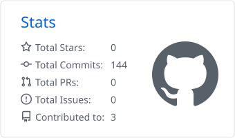
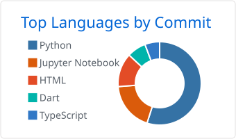

<h1 align="center">Hi 👋, I'm Swarup Kakade</h1>
<h3 align="center">AI/ML Engineer · Computer Vision · Generative AI</h3>

  

  
  
  

---

## 👨‍💻 About

AI & Data Science graduate (B.E., Mumbai University, 2026) building machine learning and computer vision systems, from research to working applications. IEEE-published author, with hands-on experience in Python, deep learning and applied ML.

- 🔭 **Currently building:** Sign Language Interpreter (computer vision)
- 📚 **Currently exploring:** Generative models, deep learning, MLOps
- 💬 **Ask me about:** Machine Learning, Computer Vision, Data Science, Python
- 📍 **Based in:** Mumbai, India
- 🤝 **Open to:** AI/ML roles, collaborations and research discussions

---

## 🏆 Highlights

- 📄 **IEEE publication:** *ArtGAN*, presented at IC3ET 2026
- 🥇 **1st Place, VNPS 2026:** AI Resume Builder
- 🎓 **B.E. in Artificial Intelligence & Data Science**, VCET, Mumbai University (CGPI 8.29)
- 💼 **Experience:** Python/ML intern at CodSoft IT Services; software development experience in industry

---

## 🚀 Featured Projects

| Project | Description | Tech |
|---|---|---|
| [**AI Image Generator**](https://github.com/swarup1606/AI-Image-Generator) | Cross-platform mobile app that generates images from text prompts | Flutter, Dart, Text-to-Image API |
| [**Customer Virtual Assistant**](https://github.com/swarup1606/Customer-Virtual-Assistant) | Voice and text customer-support assistant with a desktop GUI | Python, Tkinter, SpeechRecognition, TTS |
| [**Tours & Travels Management System**](https://github.com/swarup1606/tours-and-travels-management-system) | Web app for managing tour packages, bookings and customer inquiries | HTML, CSS |
| [**Data Science Internship**](https://github.com/swarup1606/DATA_SCIENCE_INTERNSHIP) | Internship tasks covering data analysis and ML workflows | Python, Jupyter, Pandas |

---

## 🛠️ Tech Stack

| Area | Tools |
|---|---|
| **Languages** |   |
| **ML / Deep Learning** |    |
| **Computer Vision** |  |
| **Data Analysis** |   |
| **Backend & Databases** |   |
| **Web, Design & DevOps** |     |

---

## 📊 GitHub Stats

  
  

---

<i>Always learning, always building. Let's connect!</i>

